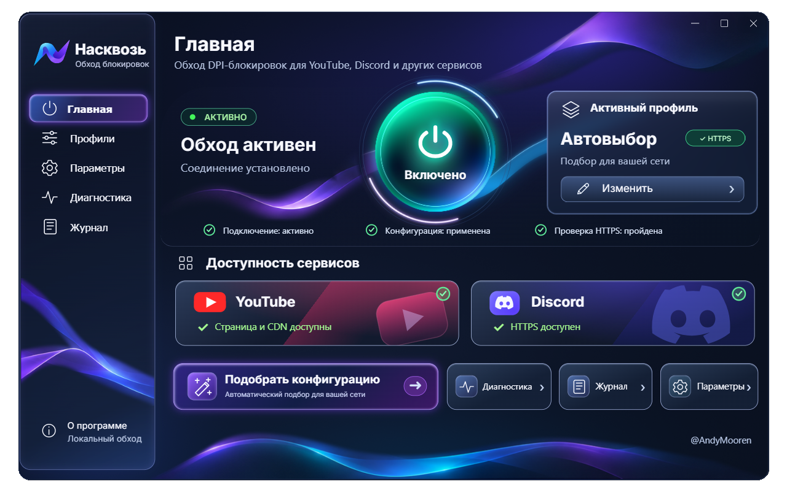

# Naskvoz · Насквозь

A Windows app that tests and selects local DPI bypass configurations for YouTube, Discord and other sites. It checks HTTPS endpoints and YouTube video servers separately.

[Русская инструкция](README.md) · [Download for Windows x64](https://github.com/RedTowerInc/naskvoz/releases/latest/download/Naskvoz-Windows-x64.zip) · [Telegram: @AndyMooren](https://t.me/AndyMooren)

## Run

1. Download `Naskvoz-Windows-x64.zip` from [Releases](https://github.com/RedTowerInc/naskvoz/releases/latest).
2. Extract the entire `Naskvoz` folder. Keep `_internal`, `engines` and `config` next to the executable.
3. Run `Naskvoz.exe` as administrator and press the central button. The first run selects and verifies a configuration for your connection.

Requires Windows 10/11 x64 and [Microsoft Edge WebView2 Runtime](https://developer.microsoft.com/microsoft-edge/webview2/). Python is bundled in the release. No proxy or remote server is required for the local bypass methods.

Initial selection takes several minutes. Stop any other DPI bypass engine before running it. Settings include IPv4/IPv6, QUIC handling, a YouTube URL for troubleshooting, manual profiles and an optional experimental Discord UDP mode.

From **2.0.1**, automatic mode checks the last working configuration first. It searches for a replacement only if that check fails. Transient failures are checked again; a failed connectivity control reports a network or DNS problem instead of starting a new search.

To update, close the app and extract the new archive into the existing folder. Keep **`data`** to preserve settings and the last working configuration. A fresh folder needs an initial selection.

HTTPS checks do not verify Discord voice. Passing the selected YouTube CDN checks does not guarantee uninterrupted playback for every video or network route. The app reports failed checks instead of treating a running engine as proof of service availability.

The app keeps settings and reports in `data` next to the executable. It does not change system DNS, proxy settings, firewall rules or startup entries. Closing the app stops its own engine.

## Contact

Report bugs through [Issues](https://github.com/RedTowerInc/naskvoz/issues) or contact [AndyMooren on Telegram](https://t.me/AndyMooren).

This repository contains the ready-to-run Windows release, instructions and screenshots. Third-party notices are included in the distribution.
