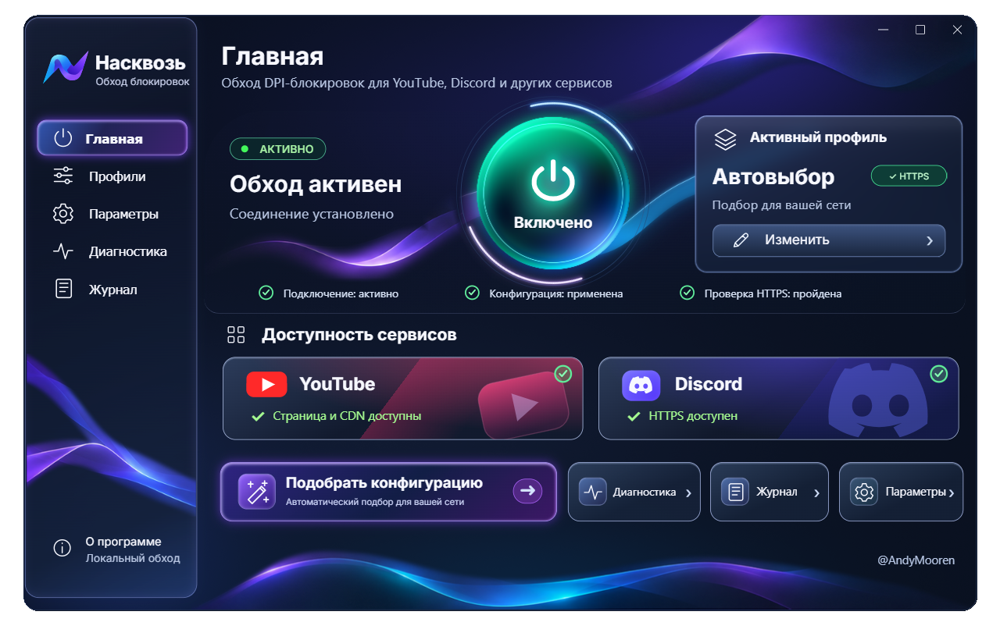

  

<h1 align="center">Насквозь · Naskvoz</h1>

Локальный обход DPI для YouTube, Discord и других сайтов на Windows

  
  

<a href="README.en.md">English</a> · <a href="#как-запустить">Запуск</a> · <a href="#если-соединение-снова-нестабильно">Если не работает</a> · <a href="https://github.com/RedTowerInc/naskvoz/releases">Все версии</a>

Насквозь подбирает локальную схему обхода DPI-блокировок под ваше подключение. В одном окне можно включить обход, проверить YouTube и Discord, сменить профиль и посмотреть, на каком этапе возникают сбои.

Программа перебирает настройки обхода и повторно проверяет подходящие варианты. Прокси или собственный сервер для этого не нужны.

## 📦 Как запустить

Нужна Windows 10/11 x64. Графический движок, Python и необходимые библиотеки уже в комплекте — отдельно устанавливать среды выполнения не нужно.

1. Скачайте **[Naskvoz-Windows-x64.zip](https://github.com/RedTowerInc/naskvoz/releases/latest/download/Naskvoz-Windows-x64.zip)**.
2. Распакуйте всю папку `Naskvoz`, например в `C:\Apps\Naskvoz`.
3. Запустите `Naskvoz.exe` и подтвердите запрос администратора. Права нужны сетевому движку для обработки пакетов.
4. Нажмите большую круглую кнопку. На первом запуске «Автовыбор» выполнит подбор, проверит найденную конфигурацию и включит обход.
5. Откройте ролик YouTube и проверьте Discord в привычном приложении.

Рядом с EXE должны оставаться папки `_internal`, `engines` и `config`. Отдельно перенесённый EXE работать не будет. Для запуска скачивайте **Naskvoz-Windows-x64.zip** из раздела Releases.

Сборка от **21 ноября 2026** использует встроенный QtWebEngine. Внешний вид и сетевые схемы сохранены. Архив занимает около **202 МиБ**, распакованная папка — **482 МиБ**. Запуск проверен на Windows 10 Pro 22H2 x64.

В версии **2.0.2** быстрый подбор останавливается на первой схеме, которая прошла полное подтверждение. Если разным сервисам нужны разные настройки, программа сохраняет их вместе. При таймаутах поиск всё ещё может занять несколько минут. Текущий этап виден в окне; подбор можно остановить.

### Сохранённая схема

При следующем включении запускается последняя рабочая схема с короткой проверкой HTTPS и видеосерверов. Программа не сравнивает весь каталог и не загружает тестовое видео заново при каждом запуске. Неудачные запросы перепроверяются.

Если один из сервисов полностью перестал отвечать после перепроверки, программа сообщает об этом и подбирает замену. Частичный сбой, например таймаут CDN Discord при работающем API, показывает предупреждение и сохраняет работающий обход. Если недоступен и контрольный сайт, программа предлагает проверить интернет или DNS. При сбое только видео обновляется только видеосхема. Ошибка определения CDN сама по себе не запускает новый поиск.

В карточке справа видно название выбранной схемы. Надпись **«Составная схема»** означает, что для сайтов и видео применяются разные профили. Нажмите **«Состав схемы»**, чтобы посмотреть их названия и домены. Тот же список есть на странице «Профили».

Кнопка **«Проверить схему»** использует сохранённый результат. Для намеренного нового поиска откройте **«Профили → Подобрать новую схему»**. В параметрах можно выбрать сравнение всех 40 вариантов: первая подтверждённая схема не обязательно самая быстрая из всего каталога.

При обновлении закройте программу и распакуйте новый архив в отдельную папку. Скопируйте в неё **`data`** из прежней папки `Naskvoz`: там находятся настройки и последняя рабочая схема. В новом пустом каталоге подбор потребуется заново.

## Что можно настроить

В комплекте 40 схем, из них 18 входят в быстрый подбор сайтов. Можно оставить автовыбор или выбрать схему вручную. Для YouTube программа отдельно проверяет видеосерверы: доступная страница ещё не означает, что загружается видео.

В параметрах есть IPv4/IPv6, режим QUIC, связанные домены сервисов и поле для ссылки на проблемный ролик. Экспериментальная обработка UDP для Discord включается отдельно. Если анимация мешает или нужна меньшая нагрузка, её можно ограничить или отключить.

Посмотреть окно параметров

Настройки и результаты сохраняются в папке `data` рядом с программой. Насквозь не меняет системные DNS, прокси, автозапуск и правила брандмауэра. При закрытии завершается только запущенный им движок.

## Если соединение снова нестабильно

Откройте **Диагностику** и запустите проверку HTTPS. Она проверяет соединение в текущем состоянии обхода. Сравнение **DNS / DoH** выполняется с выключенным обходом, чтобы проверить исходную сеть.

Если YouTube открывается, а видео зависает, укажите ссылку на ролик в параметрах и повторите подбор. При смене провайдера, роутера или подключения сохранённая схема может перестать подходить. Полный подбор доступен в параметрах.

Если обнаружен другой запущенный обход, сначала остановите его. Два движка одновременно обрабатывают один трафик и мешают проверкам друг друга.

### Что означают результаты

| В окне | Что проверено |
|---|---|
| HTTPS доступен | Тестовые HTTPS-запросы к сервису прошли |
| Страница и CDN доступны | Прошли проверки страницы и выбранных видеосерверов YouTube |
| Есть сбои | Часть запросов не прошла; движок при этом может работать |

Эти проверки не обещают отсутствие буферизации на любом ролике. Скорость зависит и от сети, и от конкретного CDN. Голос Discord нужно проверять в самом Discord. Если подходящая локальная схема не найдена, программа покажет это в результатах.

## 💬 Автор и обратная связь

Разработчик: **AndyMooren**. Написать можно в Telegram: **[@AndyMooren](https://t.me/AndyMooren)**.

Об ошибке также можно сообщить через [Issues](https://github.com/RedTowerInc/naskvoz/issues/new). Укажите версию программы, Windows, сервис и что именно происходит. Ссылка на ролик и скриншот состояния часто помогают больше, чем «не работает».

В этом репозитории размещены готовая Windows-программа, инструкция и скриншоты. Условия использования сторонних компонентов находятся в папках `licenses` и `third-party` внутри дистрибутива.

Исходный проект здесь не опубликован. Автоматические архивы GitHub **Source code** содержат только описание и изображения. Для запуска нужен **Naskvoz-Windows-x64.zip** из Releases.
