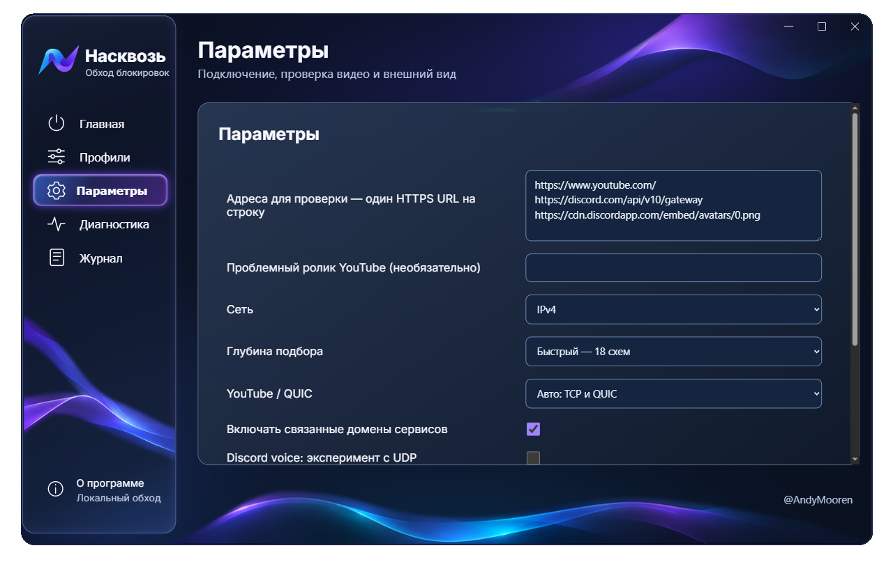

  

<h1 align="center">Насквозь · Naskvoz</h1>

Локальный обход DPI для YouTube, Discord и других сайтов на Windows

  
  

<a href="README.en.md">English</a> · <a href="#как-запустить">Запуск</a> · <a href="#если-соединение-снова-нестабильно">Если не работает</a> · <a href="https://github.com/RedTowerInc/naskvoz/releases">Все версии</a>

Насквозь подбирает локальную схему обхода DPI-блокировок под ваше подключение. В одном окне можно включить обход, проверить YouTube и Discord, сменить профиль и посмотреть, на каком этапе возникают сбои.

Программа перебирает настройки обхода и повторно проверяет подходящие варианты. Прокси или собственный сервер для этого не нужны.

## 📦 Как запустить

Нужны Windows 10/11 x64 и [Microsoft Edge WebView2 Runtime](https://developer.microsoft.com/microsoft-edge/webview2/). Python для готовой программы устанавливать не нужно.

1. Скачайте **[Naskvoz-Windows-x64.zip](https://github.com/RedTowerInc/naskvoz/releases/latest/download/Naskvoz-Windows-x64.zip)**.
2. Распакуйте всю папку `Naskvoz`, например в `C:\Apps\Naskvoz`.
3. Запустите `Naskvoz.exe` и подтвердите запрос администратора. Права нужны сетевому движку для обработки пакетов.
4. Нажмите большую круглую кнопку. На первом запуске «Автовыбор» выполнит подбор, проверит найденную конфигурацию и включит обход.
5. Откройте ролик YouTube и проверьте Discord в привычном приложении.

Рядом с EXE должны оставаться папки `_internal`, `engines` и `config`. Отдельно перенесённый EXE работать не будет. Для запуска скачивайте **Naskvoz-Windows-x64.zip** из раздела Releases.

Первичный подбор занимает несколько минут. На тестовом подключении он занял около четырёх минут; при таймаутах и полном поиске ждать придётся дольше. Текущий этап виден в окне. Подбор можно остановить.

## Что можно настроить

В комплекте 40 схем, из них 18 входят в быстрый подбор сайтов. Можно оставить автовыбор или выбрать схему вручную. Для YouTube программа отдельно проверяет видеосерверы: доступная страница ещё не означает, что загружается видео.

В параметрах есть IPv4/IPv6, режим QUIC, связанные домены сервисов и поле для ссылки на проблемный ролик. Экспериментальная обработка UDP для Discord включается отдельно. Если анимация мешает или нужна меньшая нагрузка, её можно ограничить или отключить.

Посмотреть окно параметров

Настройки и результаты сохраняются в папке `data` рядом с программой. Насквозь не меняет системные DNS, прокси, автозапуск и правила брандмауэра. При закрытии завершается только запущенный им движок.

## Если соединение снова нестабильно

Откройте **Диагностику** и запустите проверку HTTPS. Она проверяет соединение в текущем состоянии обхода. Сравнение **DNS / DoH** выполняется с выключенным обходом, чтобы проверить исходную сеть.

Если YouTube открывается, а видео зависает, укажите ссылку на ролик в параметрах и повторите подбор. При смене провайдера, роутера или подключения сохранённая схема может перестать подходить. Полный подбор доступен в параметрах.

Если обнаружен другой запущенный обход, сначала остановите его. Два движка одновременно обрабатывают один трафик и мешают проверкам друг друга.

### Что означают результаты

| В окне | Что проверено |
|---|---|
| HTTPS доступен | Тестовые HTTPS-запросы к сервису прошли |
| Страница и CDN доступны | Прошли проверки страницы и выбранных видеосерверов YouTube |
| Есть сбои | Часть запросов не прошла; движок при этом может работать |

Эти проверки не обещают отсутствие буферизации на любом ролике. Скорость зависит и от сети, и от конкретного CDN. Голос Discord нужно проверять в самом Discord. Если подходящая локальная схема не найдена, программа покажет это в результатах.

## 💬 Автор и обратная связь

Разработчик: **AndyMooren**. Написать можно в Telegram: **[@AndyMooren](https://t.me/AndyMooren)**.

Об ошибке также можно сообщить через [Issues](https://github.com/RedTowerInc/naskvoz/issues/new). Укажите версию программы, Windows, сервис и что именно происходит. Ссылка на ролик и скриншот состояния часто помогают больше, чем «не работает».

В этом репозитории размещены готовая Windows-программа, инструкция и скриншоты. Условия использования сторонних компонентов находятся в папках `licenses` и `third-party` внутри дистрибутива.
